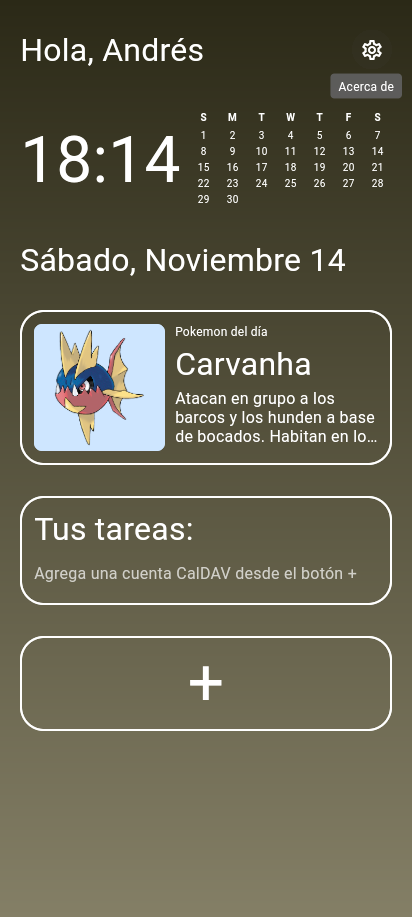
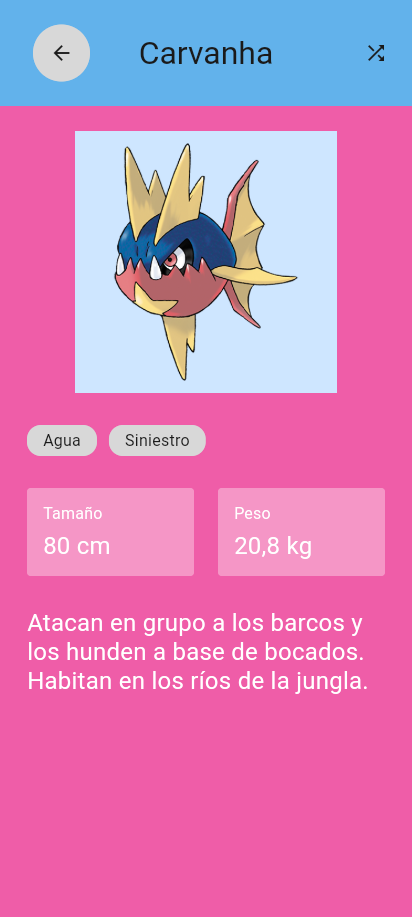
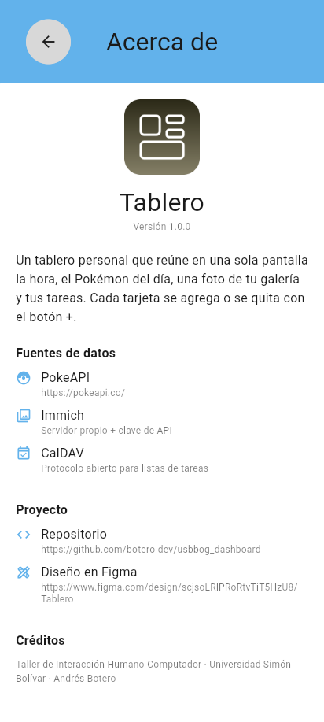
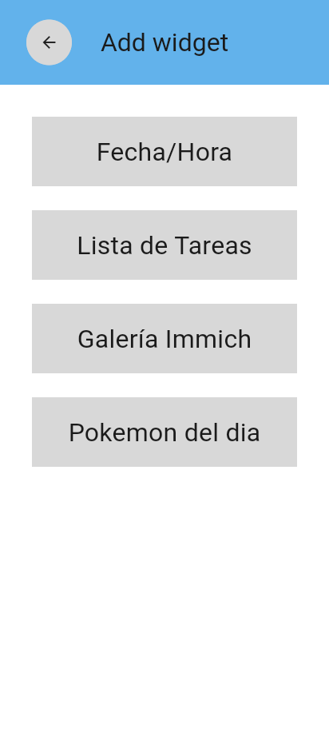

# Tablero

Aplicación Flutter que reúne en una sola pantalla lo que se consulta a lo
largo del día: la hora con un calendario del mes, el Pokémon del día, una foto
de una galería personal y la lista de tareas pendientes.



| | |
|---|---|
| **Repositorio** | <https://github.com/botero-dev/usbbog_dashboard> |
| **Diseño en Figma** | <https://www.figma.com/design/scjsoLRlPRoRtvTiT5HzU8/Tablero> |
| **Documento del proyecto** | [docs/Tablero.pdf](docs/Tablero.pdf) |

## Qué es

Un tablero personal ("glanceable dashboard") para teléfono, tablet o pantalla
secundaria. Cada tarjeta se agrega o se quita desde el mismo tablero, así que
cada persona arma la pantalla que quiere dejar abierta. La interfaz está en
español y sigue el diseño de Figma: fondo degradado verde oliva, tarjetas de
borde blanco con esquinas de 24 px y tipografía Inter.

### Pantallas

| Tablero | Pokédex | Acerca de | Add widget |
|:--:|:--:|:--:|:--:|
|  |  |  |  |

El tablero mantiene el diseño original de Figma (sin barra inferior) y cada
pantalla interna usa una barra de aplicación superior azul con título y botón
de regreso. El flujo **+** recorre *Add widget*, *Select Account/Add Account* y
*Select List*, y las tarjetas abren la ficha del Pokémon y la foto a pantalla
completa.

## Funcionalidades

- **Reloj en vivo** con mini calendario del mes y fecha larga en español.
- **Pokémon del día** desde la [PokeAPI](https://pokeapi.co/): arte oficial,
  tipos en español, tamaño, peso y descripción.
- **Pokémon al azar**: `PokemonService.random()` pide un identificador aleatorio
  entre todas las especies; se lanza desde la barra superior de la ficha del
  Pokémon. Es la función aleatoria del proyecto.
- **Galería Immich**: una foto del álbum elegido, a pantalla completa al tocarla.
- **Lista de tareas CalDAV**: lectura de VTODO y cambio de estado guardado en el
  servidor.
- **Armado del tablero**: se agregan tarjetas desde **+** y se eliminan
  manteniéndolas presionadas.
- **Estados de carga, error y reintento** en cada tarjeta, y estados de
  "falta configurar" cuando no hay cuenta.

## APIs

| Tarjeta | Fuente | Autenticación |
|---|---|---|
| Pokemon del dia | [PokeAPI](https://pokeapi.co/) — REST pública | ninguna |
| Galeria | [Immich](https://immich.app/) — REST | servidor + clave de API |
| Lista de Tareas | CalDAV (VTODO), p. ej. Fastmail o Radicale | usuario + contraseña de aplicación |

No hay credenciales en el repositorio. La galería **no viene con una tarjeta por
defecto**: se agrega desde **+** con tu servidor, o se configura en tiempo de
compilación para probar:

```bash
flutter run -d linux \
  --dart-define=IMMICH_BASE_URL=http://192.168.1.10:2283 \
  --dart-define=IMMICH_API_KEY=<clave> \
  --dart-define=CALDAV_BASE_URL=https://caldav.example.com \
  --dart-define=CALDAV_USERNAME=<usuario> \
  --dart-define=CALDAV_PASSWORD=<contraseña>
```

Con `IMMICH_API_KEY` la aplicación ofrece una cuenta *Demo* en **Select
Account**; sin la clave, solo aparece **Add Account**.

## Cómo ejecutarlo

Requiere Flutter 3.47 o superior y el SDK de la plataforma destino.

```bash
flutter pub get
flutter run -d linux      # escritorio
flutter run -d chrome     # web
flutter run -d android    # dispositivo o emulador
```

Pruebas y análisis estático:

```bash
flutter analyze
flutter test
```

Para publicar la versión web como sitio estático:

```bash
flutter build web --release --base-href /tablero/
# copiar el contenido de build/web/ al servidor
```

Si el sitio queda en la raíz del dominio, omitir `--base-href`.

## Manual de uso

### 1. Abrir el tablero

Al iniciar se muestran el saludo, la hora, la fecha, el Pokémon del día y la
tarjeta de tareas. Desliza hacia arriba para ver el resto y llegar al botón
**+**.

### 2. Abrir Acerca de

Toca el engranaje de la cabecera. Se abre **Acerca de** con la descripción, las
fuentes de datos y los enlaces al repositorio y a Figma. El botón circular de
la barra superior vuelve al tablero.

### 3. Ver la ficha de un Pokémon

Toca la tarjeta **Pokemon del día**. Se abre la Pokédex con el arte, los tipos,
el tamaño, el peso y la descripción. La flecha de la cabecera vuelve al tablero.

### 4. Pedir un Pokémon al azar

En la ficha del Pokémon toca el botón de azar de la barra superior; la ficha se
reemplaza por otra elegida al azar entre todas las especies.

### 5. Agregar una tarjeta

1. Toca **+**.
2. Elige el tipo: **Fecha/Hora**, **Lista de Tareas**, **Galería Immich** o
   **Pokemon del dia**.
3. Si la tarjeta necesita cuenta, elige una guardada o **Add Account** e ingresa
   servidor y credenciales. La aplicación valida la conexión antes de guardar.
4. Elige la lista o el álbum y vuelve al tablero con la tarjeta nueva.

### 6. Quitar una tarjeta

Mantén presionada la tarjeta y se elimina; las demás se reordenan.

### 7. Conectar Immich

En **Select Account → Add Account** ingresa el servidor (por ejemplo
`192.168.1.10:2283`) y una clave de API con permiso de lectura. El formato del
servidor se normaliza solo: una IP o un puerto explícito usan `http://`, un
dominio usa `https://`.

### 8. Conectar CalDAV

En **Add Account** ingresa la URL del servidor, el usuario y la contraseña de
aplicación. Solo se ofrecen calendarios con tareas (VTODO) y de escritura.
Marcar una casilla guarda el cambio en el servidor.

## Arquitectura

MVVM por módulos, sin librerías de estado externas:

```
vistas -> view_models (ChangeNotifier) -> services -> HTTP / almacenamiento
              |
              +-> models
```

| Carpeta | Contenido |
|---|---|
| `lib/core/theme` | tokens de color, tipografía y espaciado |
| `lib/core/utils` | fechas, cuadrícula del mes y apps del sistema |
| `lib/modules/<módulo>/models` | clases de datos puras |
| `lib/modules/<módulo>/services` | HTTP y traducción de errores |
| `lib/modules/<módulo>/view_models` | estado de pantalla y comandos |
| `lib/modules/<módulo>/views` | widgets |
| `lib/shared` | `SurfaceCard`, `PrimaryButton`, `AsyncView`, etc. |

Módulos: `about`, `accounts`, `clock`, `dashboard`, `photos`, `pokemon` y
`tasks`.

### Widgets propios

`SurfaceCard`, `PrimaryButton`, `WireframeScaffold`, `AsyncView`,
`GreetingHeader`, `AddWidgetTile`, `PokemonArtwork`, `DayCell`,
`MiniMonthCalendar`, `CheckboxRow`.

### Widgets básicos e imágenes

`Text`, `Image`, `Icon`, `Row`, `Column`, `Stack`, `Wrap`, `ListView`,
`TextField`, `Checkbox`, `SnackBar`, `CircularProgressIndicator` y
`SelectableText`. Las imágenes combinan recursos locales
(`assets/images/app_logo.png`, `assets/images/empty_board.png`) con imágenes de
red (arte de la PokeAPI y fotos de Immich).

## Pruebas

65 pruebas unitarias y de widgets (`flutter test`), sin red: PokeAPI, Immich y
CalDAV se reemplazan por clientes falsos. Cubren modelos, servicios, view
models, el flujo de armado del tablero, las pantallas internas y la función
aleatoria. `flutter analyze` no reporta problemas.

## Estructura del repositorio

```
.
|-- lib/                 # aplicación
|-- test/                # pruebas y dobles de prueba
|-- docs/
|   |-- documentacion.md # fuente del documento del proyecto
|   |-- Tablero.pdf      # documento entregable
|   `-- img/             # capturas de las pantallas
|-- assets/images/       # logotipo e ilustración del estado vacío
|-- requerimiento.jpeg   # rúbrica del taller
`-- README.md
```

## Créditos

Taller de Interacción Humano-Computador · Universidad Simón Bolívar ·
Andrés Botero.
