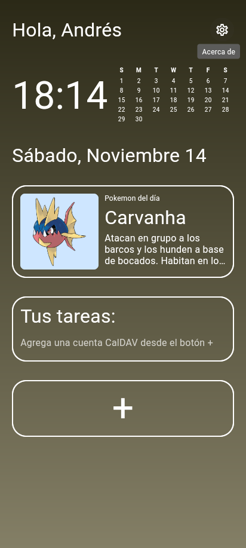
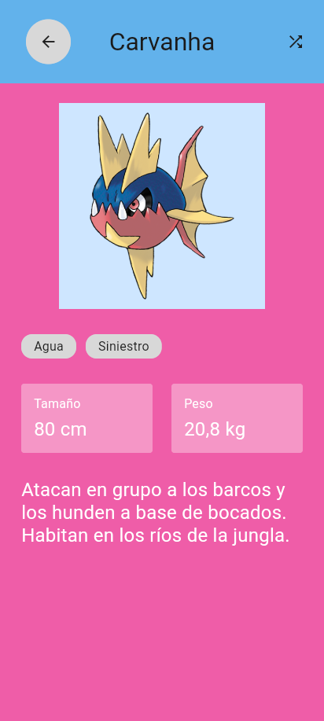
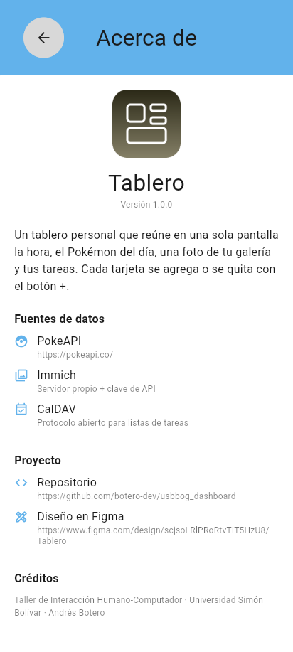
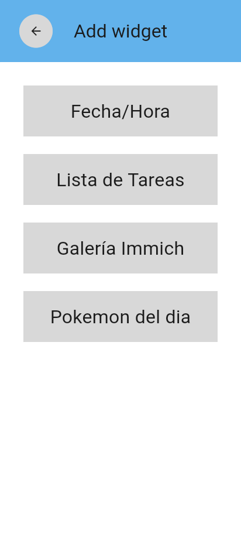

# El proyecto

**Tablero** es una aplicación Flutter que reúne en una sola pantalla la
información que se consulta a lo largo del día: la hora con un calendario
mensual, el Pokémon del día, una foto de una galería personal y la lista de
tareas pendientes. Cada tarjeta se agrega o se quita desde el mismo tablero, de
modo que cada persona arma la pantalla que quiere dejar abierta en el teléfono,
la tablet o una segunda pantalla.

El código fuente está en
<https://github.com/botero-dev/usbbog_dashboard> y el diseño de la interfaz se
realizó en Figma con auto layout y prototipo navegable:
<https://www.figma.com/design/scjsoLRlPRoRtvTiT5HzU8/Tablero>.

# 1. Objetivo

Diseñar y construir una aplicación móvil y de escritorio, usable y coherente,
que sirva como tablero personal pasivo ("glanceable"), aplicando el proceso
completo de diseño de interacción: definición de usuarios, casos de uso,
historias de usuario, prototipado en Figma y desarrollo de un producto
funcional que consume datos reales.

Objetivos específicos:

- Traducir el diseño de Figma a una aplicación Flutter con sistema de diseño,
  componentes reutilizables y auto layout.
- Consumir al menos dos APIs reales: una pública y sin credenciales (PokeAPI) y
  una de un servicio autoalojado (Immich), más una tercera de tareas (CalDAV).
- Implementar funciones propias, entre ellas una selección aleatoria.
- Entregar una aplicación navegable, ordenada y documentada, con pruebas
  automatizadas.

# 2. Target

| Dimensión | Descripción |
|:------------------|:------------------------------------------------|
| Perfil | Personas que trabajan o estudian en casa y quieren una pantalla de consulta rápida: estudiantes, docentes y profesionales entre 18 y 45 años. |
| Conocimiento | Uso cotidiano de aplicaciones móviles; no se asume conocimiento técnico. La configuración de servidores es opcional. |
| Dispositivo | Teléfono o tablet como pantalla principal; también un computador o una pantalla secundaria. El diseño parte de un lienzo de 412 × 917. |
| Necesidad | Ver de un vistazo la hora, la fecha, el Pokémon del día, una foto y las tareas, sin abrir cinco aplicaciones distintas. |
| Contexto de uso | Consultas breves y repetidas: al despertar, al empezar a trabajar y al cerrar el día. Sesiones de segundos, no de minutos. |
| Conocimiento técnico | Nulo para usar el tablero; medio solo si se conecta un servidor Immich o CalDAV propio. |

# 3. Qué es, cómo es y para qué es

**Qué es.** Un tablero personal compuesto por tarjetas independientes sobre un
fondo degradado verde oliva. No es una aplicación de productividad con flujos
largos: es una superficie de consulta.

**Cómo es.** Una pantalla principal desplazable con una cabecera de saludo y un
engranaje que abre **Acerca de**, y tarjetas de borde blanco y esquinas
redondeadas de 24 px. Las pantallas internas (agregar tarjeta, seleccionar
cuenta, lista, ficha del Pokémon y ajustes) usan una barra de aplicación
superior azul con título centrado y botón circular de regreso. Cada tarjeta tiene un estado de
carga, uno de error con reintento y su contenido. El lenguaje visual viene del
archivo de Figma: tipografía Inter, texto blanco sobre el degradado, azul de
cabecera en las pantallas de configuración y rosa para la ficha del Pokémon.

**Para qué es.** Para tener en una sola pantalla lo que se consulta todo el
tiempo. El valor está en la personalización: se empieza con reloj, Pokémon y
tareas, y cada persona agrega la galería de fotos o una segunda tarjeta de
tareas si le sirve. Las tarjetas se eliminan manteniéndolas presionadas.

# 4. Casos de uso

**Caso de uso principal: consultar el tablero al empezar el día.**

1. La persona abre la aplicación y ve el saludo, la hora en vivo con el mes, la
   fecha completa, el Pokémon del día y sus tareas.
2. Desliza para recorrer las tarjetas; cada una muestra su contenido ya cargado
   o un mensaje con la opción de reintentar.
3. Toca la tarjeta del Pokémon y llega a la ficha con el arte oficial, los
   tipos, el tamaño, el peso y la descripción en español.
4. Vuelve con la flecha de la cabecera y sigue en el tablero.

**Caso de uso secundario: armar el tablero.**

1. Toca el botón **+** al final de la lista y entra a **Add widget**.
2. Elige un tipo de tarjeta: Fecha/Hora, Lista de Tareas, Galería Immich o
   Pokemon del dia.
3. Si la tarjeta necesita una cuenta, elige una guardada o crea una nueva
   (**Add Account**) indicando servidor y credenciales; la aplicación valida la
   conexión antes de guardar.
4. Elige la lista o el álbum y vuelve al tablero, donde la tarjeta nueva ya
   aparece.
5. Para quitarla, la mantiene presionada.

**Caso de uso secundario: descubrir otro Pokémon.**

1. Toca la tarjeta **Pokemon del dia** para abrir su ficha.
2. Toca el botón de azar en la barra superior para consultar otro Pokémon al
   azar entre todas las especies de la PokeAPI, sin salir de la ficha.

**Caso de uso secundario: conocer el proyecto.**

1. Toca el engranaje de la cabecera y entra a **Acerca de**, con la descripción,
   las fuentes de datos y los enlaces al repositorio y al diseño.

# 5. Historias de usuario

| ID | Historia | Criterios de aceptación |
|:-------|:---------------------------|:----------------------------------|
| HU-01 | Como usuario, quiero ver la hora y la fecha al abrir la aplicación, para orientarme sin mirar otro dispositivo. | La tarjeta muestra la hora en vivo (se actualiza cada minuto), el mes con el día actual resaltado y la fecha larga en español. |
| HU-02 | Como usuario, quiero ver un Pokémon del día, para tener un detalle distinto cada jornada. | La tarjeta carga el Pokémon calculado a partir del día del año; muestra arte oficial, nombre y descripción; si falla la red aparece un mensaje con **Reintentar**. |
| HU-03 | Como usuario, quiero abrir la ficha de un Pokémon, para conocer sus tipos y medidas. | Al tocar la tarjeta se abre la Pokédex con tipos en español, tamaño, peso y descripción; la flecha vuelve al tablero. |
| HU-04 | Como usuario, quiero pedir otro Pokémon al azar, para explorar la Pokédex. | El botón de azar de la barra superior consulta un identificador aleatorio entre 1 y el total de especies y reemplaza la ficha sin salir de ella. |
| HU-05 | Como usuario, quiero agregar tarjetas desde el tablero, para armarlo a mi gusto. | El botón **+** abre **Add widget**; al elegir un tipo y, si aplica, una cuenta y una lista, la tarjeta aparece al final del tablero. |
| HU-06 | Como usuario, quiero conectar mi servidor Immich, para ver mis fotos. | El formulario valida servidor y clave de API antes de guardar; la tarjeta muestra una foto del álbum elegido y el toque la abre a pantalla completa. |
| HU-07 | Como usuario, quiero conectar mi calendario CalDAV, para ver y completar tareas. | La aplicación descubre el calendario, lista solo las listas con tareas, muestra las pendientes y guarda el cambio al marcar una casilla. |
| HU-08 | Como usuario, quiero quitar tarjetas que no uso, para simplificar la pantalla. | Mantener presionada una tarjeta la elimina y reordena el resto. |
| HU-09 | Como usuario, quiero que las pantallas internas tengan una barra superior clara, para saber dónde estoy y cómo volver. | Cada pantalla interna muestra un `AppBar` azul con su título y un botón circular de regreso que devuelve a la pantalla anterior. |
| HU-10 | Como usuario, quiero entender de dónde vienen los datos, para confiar en la aplicación. | La pantalla **Acerca de**, abierta desde el engranaje, lista las fuentes de datos, el repositorio y el diseño en Figma. |
| HU-11 | Como usuario, quiero que la aplicación se adapte a mi pantalla, para usarla en teléfono o escritorio. | La interfaz se construye con layouts flexibles; el contenido se desplaza sin desbordarse en 412 × 917 y en ventanas grandes. |
| HU-12 | Como usuario, quiero ver mensajes claros cuando algo falla, para saber qué hacer. | Cada tarjeta distingue carga, error con **Reintentar** y falta de configuración, con textos en español. |

# 6. Diseño visual

## 6.1 Sistema de diseño

El diseño se construyó en Figma con auto layout y un sistema de tokens que se
traduce uno a uno en `lib/core/theme/app_theme.dart`:

| Token | Valor | Uso |
|:------------------|:------------------|:------------------|
| Fondo | degradado `#2B2917` -> `#847F66` | tablero |
| Texto | blanco, Inter | tablero |
| Títulos | 64 / 32 / 24 / 16 / 12 / 10 px | hora, saludo, tarjetas, cuerpo, pie, días |
| Tarjeta | radio 24 px, borde blanco de 2 px | todas las tarjetas |
| Cabecera de configuración | `#62B2EB`, 106 px | Add widget y Select |
| Botón | `#D8D8D8`, 87 px de alto | acciones de las pantallas de configuración |
| Acción principal | `#9FADFF` | Connect |
| Ficha Pokémon | `#EF5DA8` / `#CEE6FF` | fondo y marcador de imagen |

## 6.2 Componentes reutilizables

`SurfaceCard`, `PrimaryButton`, `WireframeScaffold`, `AsyncView`,
`GreetingHeader`, `AddWidgetTile`, `PokemonArtwork`, `DayCell`,
`MiniMonthCalendar` y `CheckboxRow`. Todos se usan en más de una pantalla y
concentran el estilo, de modo que un cambio de token se propaga solo.

## 6.3 Pantallas

{width=24%}
{width=24%}
{width=24%}
{width=24%}

De izquierda a derecha: tablero con reloj, Pokémon y tareas; ficha del Pokémon
con la acción de azar en la barra superior; Acerca de, abierta desde el
engranaje; y el selector de tarjetas del flujo **+**. Las tres últimas usan el
mismo `AppBar` azul con botón circular de regreso.

## 6.4 Navegación

```
Tablero
|-- tarjeta Pokémon      -> Pokédex (ficha)             <- volver
|   `-- acción de azar    -> otro Pokémon (misma ficha)
|-- tarjeta Galería      -> Foto a pantalla completa     <- volver
|-- mantener presionada  -> elimina la tarjeta
|-- botón +              -> Add widget                   <- volver
|   |-- Fecha/Hora       -> nueva tarjeta
|   |-- Pokemon del dia  -> nueva tarjeta
|   |-- Galería Immich   -> Select Account -> Select List
|   `-- Lista de Tareas  -> Select Account -> Select List
`-- engranaje           -> Acerca de                     <- volver
```

Son siete pantallas funcionales (tablero, ficha, foto, Acerca de, Add widget,
Select Account con Add Account y Select List), por encima del mínimo de cuatro.

# 7. Arquitectura y tecnologías

| Capa | Tecnología |
|:-----------------------|:------------------------------------|
| Interfaz | Flutter 3.47 / Dart 3.13, Material 3 |
| Estado | MVVM con `ChangeNotifier` y `ListenableBuilder` (sin librerías externas) |
| Datos | PokeAPI (REST), Immich (REST con clave de API), CalDAV (VTODO) |
| HTTP | `package:http`; `package:caldav` para WebDAV |
| Diseño | Figma con auto layout y prototipo |
| Pruebas | `flutter_test`, 65 pruebas unitarias y de widgets |

El código se organiza por módulo, con la misma estructura en todos:

```
lib/
|-- app.dart                 # MaterialApp + tema
|-- main.dart                # punto de entrada
|-- core/
|   |-- theme/app_theme.dart # tokens de color, tipografía y espaciado
|   `-- utils/               # formateo de fechas, cuadrícula del mes, apps del sistema
|-- modules/
|   |-- about/               # pantalla Acerca de
|   |-- accounts/            # selección y alta de cuentas
|   |-- clock/               # reloj y mini calendario
|   |-- dashboard/           # tablero, tarjetas y armado del tablero
|   |-- photos/              # galería Immich
|   |-- pokemon/             # PokeAPI, tarjeta y Pokédex
|   `-- tasks/               # CalDAV
`-- shared/                  # widgets y vistas reutilizables
```

Cada módulo separa `models/` (datos puros), `services/` (HTTP y errores),
`view_models/` (estado de pantalla) y `views/` (widgets). Ninguna vista conoce
un código de estado HTTP y ningún servicio conoce un widget.

## 7.1 Las tres APIs

| Tarjeta | Fuente | Credenciales | Estado |
|:------------------|:------------------|:------------------|:------------------|
| Pokemon del dia | PokeAPI (`https://pokeapi.co/api/v2`) | ninguna | funcionando |
| Galeria | Immich (REST) | servidor + clave de API | funcionando con servidor propio |
| Lista de Tareas | CalDAV (VTODO) | servidor + usuario + contraseña | funcionando con cuenta propia |

La aplicación no incluye credenciales en el repositorio. Para probar las
integraciones se pasan en tiempo de compilación:

```bash
flutter run \
  --dart-define=IMMICH_BASE_URL=http://192.168.1.10:2283 \
  --dart-define=IMMICH_API_KEY=<clave> \
  --dart-define=CALDAV_BASE_URL=https://caldav.example.com \
  --dart-define=CALDAV_USERNAME=<usuario> \
  --dart-define=CALDAV_PASSWORD=<contraseña>
```

## 7.2 Funciones y widgets propios

- **Aleatorio:** `PokemonService.random()` obtiene el total de especies y pide
  un identificador al azar con `Random`; la acción de la barra superior de la
  ficha del Pokémon lo usa.
- **Widgets personalizados:** tarjetas con borde y radio propios, botón de 87
  px, cabecera azul con botón circular, vista asíncrona con reintento, reloj,
  mini calendario, fila de tarea con casilla y arte del Pokémon.
- **Widgets básicos:** `Text`, `Image` (asset y network), `Icon`, `Row`,
  `Column`, `Stack`, `Wrap`, `ListView`, `TextField`, `Checkbox`, `SnackBar`,
  `CircularProgressIndicator` y `SelectableText`.
- **Imágenes:** el logotipo y la ilustración del estado vacío son recursos
  locales (`assets/images/`); el arte del Pokémon y las fotos de Immich llegan
  por red.

# 8. Cómo ejecutarlo

Requisitos: Flutter 3.47 o superior y el SDK de la plataforma destino.

```bash
flutter pub get
flutter run -d linux      # escritorio
flutter run -d chrome     # web
flutter run -d android    # dispositivo o emulador
```

Pruebas y análisis:

```bash
flutter analyze
flutter test
```

Para publicar la versión web como sitio estático:

```bash
flutter build web --release --base-href /tablero/
# copiar build/web/ al servidor o a un hosting estático
```

Si el sitio vive en la raíz del dominio, omitir `--base-href`.

# 9. Estado de la entrega

| Entregable | Criterio | Estado |
|:------------------|:--------------------------------|:----------|
| Repositorio | Público, ordenado y con README y manual de uso | Cumplido |
| Documento PDF | Descripción, target, qué es y para qué, casos de uso, historias de usuario y diseño visual | Este documento |
| Figma | Sistema de diseño, componentes, auto layout, prototipado y diseño visual | Cumplido |
| Aplicativo | Tres APIs, navegación de siete pantallas, AppBar en las pantallas internas, funciones (aleatorio), widgets propios, widgets básicos e imágenes locales y de red | Cumplido |
| Despliegue | Instrucciones de compilación y publicación estática | Incluidas en la sección 8 |
